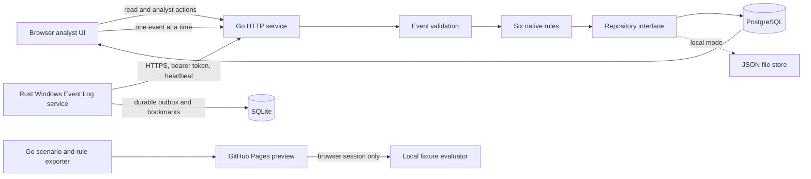

# Architecture

SENTINEL currently ships as a Go service, a static browser UI, and a Rust Windows Event Log service. PostgreSQL is the persistent service path when `SENTINEL_DATABASE_URL` is configured; a local JSON store remains available for dependency-free development. GitHub Pages runs only a browser-side preview.

## Current components

- `internal/model`: Sentinel schema `1.0` events, alerts, incidents, and derived endpoint records. The schema borrows concepts from OCSF but is not conformant.
- `internal/detection`: six enabled, revisioned rules using case-insensitive field conditions; three also correlate bounded event counts by host/run and, for network activity, destination.
- `internal/simulator`: six fictional fixtures with declared expected rule IDs. It performs no host activity.
- `internal/store`: repository interface; mutex-protected JSON development store; PostgreSQL implementation using pgx, embedded versioned SQL migrations, indexes, transactional event/alert/case/audit writes, and normalized evidence links.
- `cmd/sentinel`: validation, bearer-token checks on writes, API routes, response headers, request limits, local listener, optional HTTPS, and backend selection.
- `POST /api/heartbeat`: persists authenticated endpoint version, configured channels, declared capabilities, and server receipt time. Fleet freshness expires after 90 seconds; optional mTLS binds heartbeat host identity to the certificate URI SAN.
- `web`: static responsive dashboard for local API operation and the browser-only Pages preview.

Local `/api/ingest` and paced scenario replay both call the same event-processing path. A matching event produces an alert linked to the original event. Alerts are grouped into an incident by host and simulation run. Analyst status, assignment, and note changes are persisted and audit-logged. Reset removes records for one simulation run while retaining a reset audit entry.

GitHub Pages cannot run the Go service. The workflow exports scenario and rule fixtures from the Go source; `web/app.js` applies those conditions in the browser. Simulation records are saved in that browser profile's local storage. This preview has no backend or authentication and is not the Go detector runtime.

## Deliberate limitations

Automated endpoint enrollment, certificate rotation/revocation, event pagination, live push, user account/session lifecycle, a general-purpose correlation language, Sigma parsing, YARA scanning, and response actions are not implemented. Write endpoints have process-local per-IP token buckets with bounded state; this does not coordinate replicas or distinguish users behind a shared proxy. Optional mTLS verifies any presented certificate; `/api/ingest` and `/api/heartbeat` require the leaf URI SAN to match the host ID. Operators provision per-host certificates out of band, and both endpoints still require the shared bearer token. Heartbeat source and capability values are self-reported; connected means a heartbeat was received within 90 seconds. Sensitive read APIs require configured analyst or administrator bearer access. Only the administrator can reset simulations. This is not a full identity service. PostgreSQL integration tests passed in CI; JSON mode is unsuitable for concurrent replicas, large datasets, or production retention. Keep the listener on loopback unless TLS, trust, access control, and deployment are deliberately configured.
